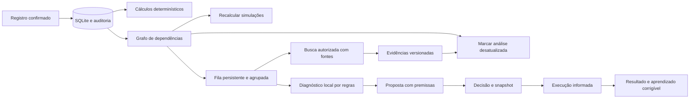

# Decisões técnicas e escopo

O projeto não continha arquivos ou commits. Foram criados código e modelo relacional novos, sem alegação de ter corrigido um sistema anterior. A escolha de SQLite permite executar e testar o núcleo sem contratar banco ou serviço externo; interfaces de busca e IA ficam no servidor.

## Fluxo integrado

## Integridade

- Uma venda, vários itens e recebimentos separados. Parcelas são metadado comercial.
- Centavos inteiros; taxas proporcionais por divisão inteira e distribuição dos restos, sem perder centavos.
- Sem divisão confirmada, não existe receita individual do combo. Sem custo, não existe margem definitiva.
- Custos de catálogo têm vigência. Custos efetivos ficam no item do atendimento e não dependem da cotação atual.
- Consumo efetivo detalhado também pode ser enviado pela API `/api/sale-items/:id/consume`; fixa custo histórico e baixa estoque. A tela permite informar o custo efetivo total com origem, sem inventar quantidades.
- Compra de estoque gera uma saída financeira de categoria estoque e um movimento de entrada, em uma única transação. O resultado usa consumo, sem abater a compra integral novamente.
- Mutações locais e sua resposta idempotente são gravadas na mesma transação. Savepoints mantêm a atomicidade de operações compostas. Importações em lote são totalmente revertidas em caso de conflito.
- Eventos preservam valores anteriores, novos valores, motivo, origem e impactos. A decisão guarda a recomendação e registros de apoio disponíveis ao decidir, além da referência viva para revisões futuras.
- Preferências explícitas são persistidas e consultáveis; rejeições isoladas não viram regras. O motor local atual prioriza qualidade dos dados e acompanhamento, sem inferência causal ou aprendizado automático.

## Dependências e processamento

`dependencies(source_type, source_id, target_type, target_id, mode)` representa relações explícitas. `*` representa todos os registros de um tipo quando a análise usa um agregado. A inclusão procura ciclos; a propagação usa um conjunto de visitados. Dependências externas apenas indicam necessidade de autorização, nunca enviam mensagens ou publicam.

Alteração de custo → simulações vinculadas, apenas na vigência aplicável. Recebimentos e rateios → resumos calculados na consulta e revisão agrupada do diagnóstico. Evidência → recomendação desatualizada, com decisão bloqueada até revisão. Aceite de orçamento → oportunidade atualizada e próximo passo registrado, sem criar venda ou crédito automaticamente.

`jobs` mantém chave de deduplicação, estado, tentativas, próximo horário e erro. Diagnósticos próximos compartilham uma tarefa. Buscas usam no máximo três tentativas com espera progressiva, não repetem falhas de autorização/limite e não inventam evidências. Tarefas interrompidas de leitura/análise podem ser retomadas; conclusão e evidências são persistidas em transação. Recorrências podem ser pausadas.

O worker é parte do processo Node. Snapshot de ambiente preserva arquivos, não um processo vivo. Escala de vários workers, fila distribuída, múltiplas clínicas e entrega garantida de ações externas estão fora desta versão.

## Serviços externos

Busca Brave e interpretação OpenAI são adaptadores reais, desabilitados ou bloqueados sem configuração. O provedor não foi chamado com credenciais reais. O teste do adaptador usa resposta explicitamente fictícia e verifica validação/proveniência; não é evidência de pesquisa pública realizada.

Leitura por URL usa domínios explícitos, HTTPS, sem redirects, tamanho e tempo limitados. Sem proxy, os endereços resolvidos são validados como públicos. Na rota gerenciada de proxy HTTPS, somente hostnames já aprovados usam a resolução do proxy; não é exigido DNS direto no container. IPs privados continuam bloqueados. Resultados são texto não confiável, nunca comandos ou HTML executável. Falhas de proxy, login, domínio não permitido ou conteúdo ilegível são retornadas ao usuário.

## Continuidade

Para uso de produção, ainda é necessário escolher hospedagem, volume persistente, supervisionar o processo, configurar HTTPS e acesso, backup externo e monitoramento. Nenhum serviço foi contratado ou publicado. Nesta máquina, startup e testes podem ser reproduzidos com as instruções salvas na configuração do ambiente.
